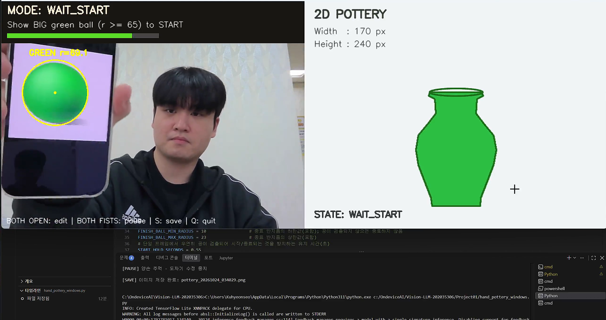
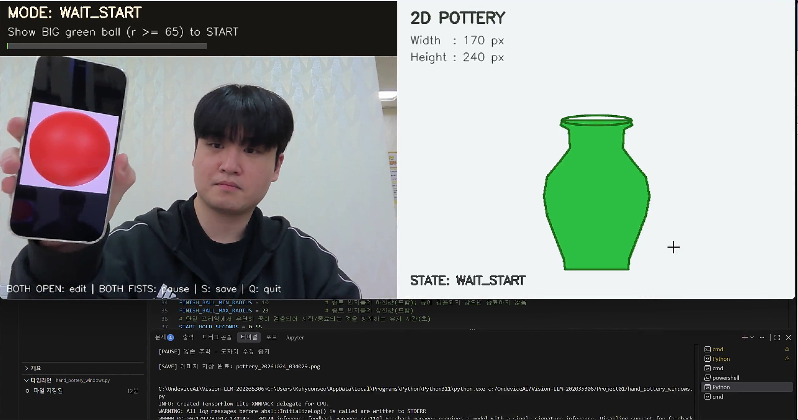
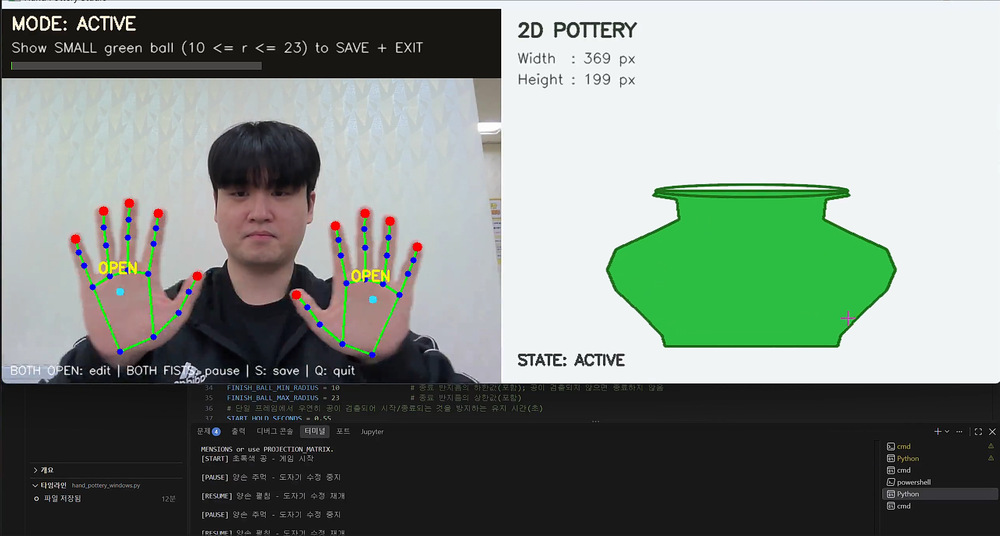
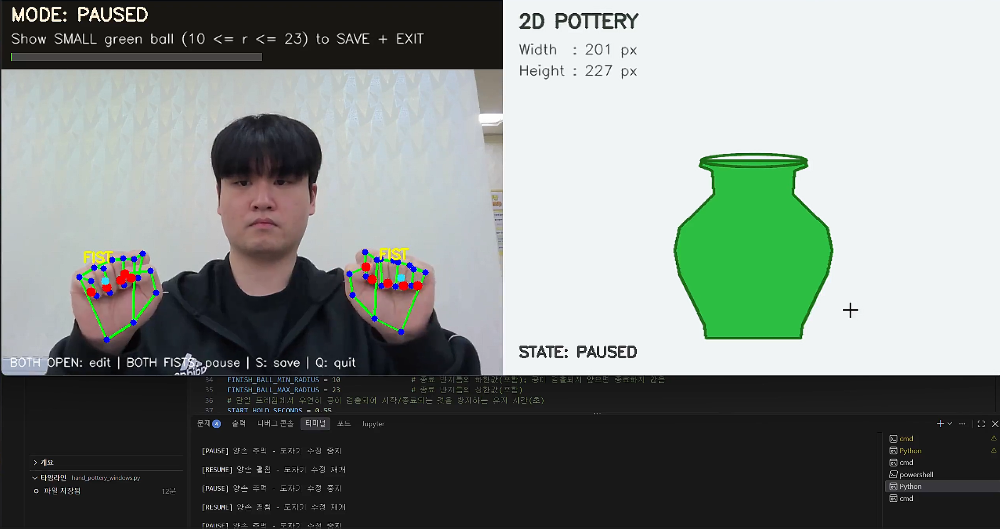
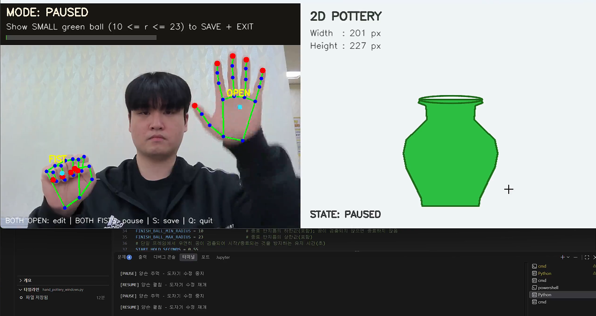
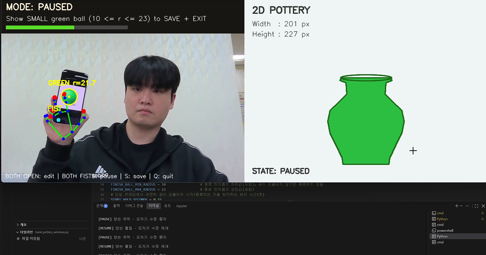
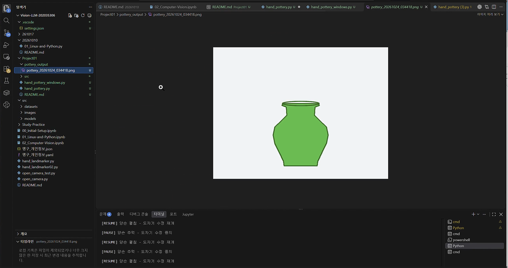

# Hand Pottery Studio

**손동작으로 빚는 2D 도자기**

웹캠으로 초록색 공과 양손의 움직임을 인식하여 2D 도자기의 폭과 높이를 조절하는 프로젝트입니다.

초록색 공으로 시작과 종료를 제어하고, 
양손을 펼치거나 주먹을 쥐어 도자기 편집을 재개하거나 일시정지할 수 있습니다.

## 주요 기능

- **게임 시작 :** 초록색 공을 카메라에 가까이 보여주면 게임이 시작됩니다.
- **크기 조절 :** 양손을 펼친 상태에서 좌우 간격으로 도자기의 폭을, 양손의 평균 상하 위치로 높이를 조절합니다.
- **일시정지 :** 양손을 모두 주먹 쥐면 도자기 크기가 고정됩니다.
- **편집 재개 :** 양손을 다시 펼치면 그 순간의 손 위치와 도자기 크기를 새 기준으로 삼아 상대적으로 조절합니다.
- **저장 및 종료 :** 초록색 공이 정해진 작은 크기로 일정 시간 검출되면 도자기 이미지를 PNG로 저장하고 종료합니다.

## 폴더 구조

```text
Project01/
├── hand_pottery.py             # Jetson 실행용
├── hand_pottery_windows.py     # Windows 실행용
├── README.md
├── src/
│   └── models/
│       └── MediaPipe/
│           └── hand_landmarker.task
└── pottery_output/            # 실행 후 생성되는 이미지 저장 폴더
```

두 실행 파일은 카메라 입력 방식만 다르며, 공 검출과 손 제스처 판별 및 도자기 조절 방법은 동일합니다.

모델 파일은 각 `.py` 파일과 같은 위치의 `src/models/MediaPipe/hand_landmarker.task`에 있어야 합니다.

## 실행 환경

- Python 3
- OpenCV (`cv2`)
- NumPy (`numpy`)
- MediaPipe Tasks API (`mediapipe`)
- 웹캠 및 `hand_landmarker.task` 모델 파일

Jetson에서는 `/dev/video0`의 V4L2 카메라를 **GStreamer**로 연결합니다(YUY2, 640×480, 30fps).

Windows에서는 기본 웹캠(장치 번호 `0`)을 **DirectShow**로 연결합니다. 각 환경에 맞는 OpenCV 및 MediaPipe 설치가 필요합니다.

### 실행 방법

저장소 최상위 폴더에서 다음 명령어를 실행합니다.

**Jetson**

```bash
python3 Project01/hand_pottery.py
```

**Windows**

```powershell
python Project01/hand_pottery_windows.py
```


## 조작 방법

| 동작 | 결과 |
|---|---|
| 큰 초록색 공을 보여주기 | 게임 시작 (반지름 65px 이상, 0.55초 유지) |
| 양손 펼치고 좌우로 벌리기 / 모으기 | 도자기 폭 증가 / 감소 |
| 양손 펼치고 함께 올리기 / 내리기 | 도자기 높이 증가 / 감소 |
| 양손 모두 주먹 쥐기 | 도자기 수정 일시정지 (0.25초 유지) |
| 양손 모두 펼치기 | 현재 위치를 새 기준으로 편집 재개 (0.25초 유지) |
| 작은 초록색 공을 보여주기 | PNG 저장 후 종료 (반지름 10~23px, 1.2초 유지) |
| `S` | 수동 저장 후 종료 |
| `Q` 또는 `ESC` | 저장 없이 종료 |

초록색 공이 **검출되지 않을 때는 종료하지 않으며**, 게임 시작 직후 2초 동안은 종료 조건을 검사하지 않습니다. 

공의 반지름 기준은 640×480 프레임 기준으로 설정되어 있습니다.


# 실행 결과

## 1. 초록색 공으로 게임 시작



<br>

## 2. 다른 색상의 공 구분



<br>

## 3. 양손으로 도자기 크기 조절



<br>

## 4. 양손 주먹으로 일시정지



<br>

## 5. 한 손만 펼친 상태



<br>

## 6. 작은 초록색 공으로 저장 및 종료



<br>

## 7. 최종 저장 결과



<br>

# 시연 영상

[전체 시연 영상 보기](demo/demo.mp4)

## 전체 시연 영상


https://github.com/user-attachments/assets/7527561d-5b10-4d1a-bfc0-db1a2f393605


## 사용 기술 및 구현 방법

| 기술 | 적용 방법 |
|---|---|
| 이미지 조정 | 640×480 크기 조절 및 거울처럼 보이도록 좌우 반전 |
| 색공간 변환 | BGR → LAB(공 검출), BGR → RGB(손 인식) |
| Image Enhancement | LAB의 밝기 채널에 CLAHE 적용 |
| 필터링 및 잡영역 제거 | 작은 Contour와 원형도가 낮은 영역을 제외하여 오검출 감소 |
| Color Segmentation | LAB 색상 범위로 초록 공 마스크 생성 |
| Contour Detection | 마스크의 외곽선을 검출하고 최소 외접원으로 중심과 반지름 계산 |
| 객체 추적 | 매 프레임 초록 공과 양손의 위치를 검출하고 시간에 따른 상태 변화 처리 |
| 신체 인식 | MediaPipe HandLandmarker로 양손의 21개 랜드마크 검출 |

손가락의 펼침 여부는 관절 세 점으로 계산한 각도가 **160도 이상**인지에 따라 판단합니다.

엄지를 제외한 네 손가락이 모두 펴지면 `OPEN`, 펴진 손가락이 0~1개이면 `FIST`, 그 외에는 `OTHER`로 분류합니다.

### 상대적인 크기 조절

손의 위치를 도자기 크기에 직접 대입하지 않고, **편집을 시작하거나 재개한 순간**의 값을 기준으로 변화량을 계산합니다.

- **폭:** 시작 시 도자기 폭 + (현재 양손 가로 간격 − 시작 시 양손 가로 간격)
- **높이:** 시작 시 도자기 높이 + (시작 시 양손 평균 세로 좌표 − 현재 양손 평균 세로 좌표)

두 값은 조절 범위 안에서 제한하고, 화면에서 갑자기 튀지 않도록 부드럽게 반영합니다.

## 핵심 구현 원리

### 1. LAB 색상 분할과 Contour를 이용한 초록 공 검출

카메라 영상을 LAB 색공간으로 변환하고, 밝기를 나타내는 L 채널에 CLAHE를 적용합니다.

이후 초록색 범위에 해당하는 영역만 마스크로 분리하고, 
가장 큰 Contour에서 공의 중심과 반지름을 구합니다.

```python
lab_frame = cv2.cvtColor(frame, cv2.COLOR_BGR2LAB)
lightness_channel, a_channel, b_channel = cv2.split(lab_frame)

clahe = cv2.createCLAHE(clipLimit=3.0, tileGridSize=(8, 8))
enhanced_lab = cv2.merge((clahe.apply(lightness_channel), a_channel, b_channel))

shape_mask = cv2.inRange(enhanced_lab, GREEN_LOWER_LAB, GREEN_UPPER_LAB)
detected_contours, _ = cv2.findContours(
    shape_mask, cv2.RETR_EXTERNAL, cv2.CHAIN_APPROX_SIMPLE
)
```

검출된 Contour의 면적과 원형도를 검사한 후 `cv2.minEnclosingCircle()`로 반지름을 계산합니다.

공이 없거나 조건을 만족하지 못하면 `None`을 반환합니다.

이 반지름으로 시작과 종료 조건을 구분하며, 조건이 일정 시간 유지될 때만 동작하도록 처리했습니다.

### 2. 손가락 관절 각도를 이용한 제스처 판별

MediaPipe HandLandmarker가 제공하는 손의 랜드마크 중 세 점의 각도를 계산하여 손가락이 펴졌는지 확인합니다.

주먹과 펼침 상태는 엄지를 제외한 네 손가락으로 판단합니다.

```python
straight_finger_count = sum(
    calculate_joint_angle(hand_landmarks[i], hand_landmarks[j], hand_landmarks[k])
    >= FINGER_STRAIGHT_ANGLE
    for i, j, k in FINGER_ANGLE_POINTS[1:]
)

hand_gesture = (
    'OPEN' if straight_finger_count == 4
    else 'FIST' if straight_finger_count <= 1
    else 'OTHER'
)
```

관절 각도 기준은 **160도**입니다. 네 손가락 모두 펴지면 `OPEN`, 0~1개만 펴지면 `FIST`, 나머지는 `OTHER`로 분류합니다.

양손이 같은 제스처를 **0.25초 동안 유지**해야 편집 상태가 전환됩니다.

### 3. 손의 상대적인 움직임을 이용한 도자기 크기 조절

도자기를 조절하기 시작한 시점의 **양손 간격·평균 높이·도자기 크기**를 `start_` 변수에 저장합니다.

이후에는 현재 손 위치와 시작 위치의 차이만 반영합니다.

```python
desired_pot_width = limit_range(
    start_pot_width
    + (hand_horizontal_distance - start_hand_distance) * WIDTH_CHANGE_SPEED,
    POT_MIN_WIDTH,
    POT_MAX_WIDTH
)

desired_pot_height = limit_range(
    start_pot_height
    + (start_hand_y - hands_average_y) * HEIGHT_CHANGE_SPEED,
    POT_MIN_HEIGHT,
    POT_MAX_HEIGHT
)
```

- **폭:** 양손 사이의 가로 간격이 넓어지면 증가합니다.
- **높이:** 양손의 평균 위치가 위로 올라가면 증가합니다.  이미지 좌표의 y값은 아래로 갈수록 커지므로 차이를 반대로 계산합니다.
- **재개:** 주먹을 쥐었다가 다시 펼치면 현재 손 위치와 도자기 크기를 새로운 시작값으로 저장해 크기가 갑자기 바뀌지 않도록 합니다.

계산된 목표 크기는 최솟값과 최댓값 사이로 제한하며, 스무딩 계수를 이용해 실제 크기에 점진적으로 반영합니다.

### 4. 게임 상태 전환

게임은 `WAIT_START`(시작 대기), `ACTIVE`(편집 중), `PAUSED`(일시정지)의 세 가지 상태로 관리합니다.

```python
if state == 'ACTIVE' and fists_held_long_enough:
    state = 'PAUSED'
    reset_start_position = True
elif state == 'PAUSED' and open_held_long_enough:
    state = 'ACTIVE'
    reset_start_position = True
```

큰 초록색 공으로 게임을 시작하고, `ACTIVE`에서는 양손 움직임으로 도자기 크기를 변경합니다.

양손 주먹으로 `PAUSED`에 들어가면 현재 크기가 유지되고, 양손을 다시 펼치면 새로운 상대 조절 기준으로 편집을 재개합니다.

작은 초록색 공이 정해진 반지름 범위에서 일정 시간 검출되면 이미지를 저장하고 종료합니다.

## 결과 저장

도자기를 저장하면 `Project01/pottery_output/` 폴더에 다음과 같은 이름으로 PNG 파일이 생성됩니다.

```text
pottery_YYYYMMDD_HHMMSS.png
```

저장 이미지에는 웹캠 영상이나 안내 문구를 제외한 **초록색 2D 도자기 그림**이 포함됩니다.

## 참고 사항

- 조명과 카메라에 따라 초록색 공의 검출 범위가 달라질 수 있습니다.
- 손이 가려지거나 손가락 관절이 잘 보이지 않으면 제스처 판별이 불안정할 수 있습니다.
- 도자기 형태는 고정된 2D 실루엣이며, 폭과 높이 두 값만 조절합니다.
