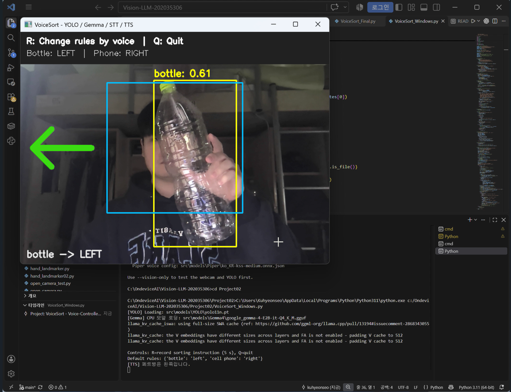
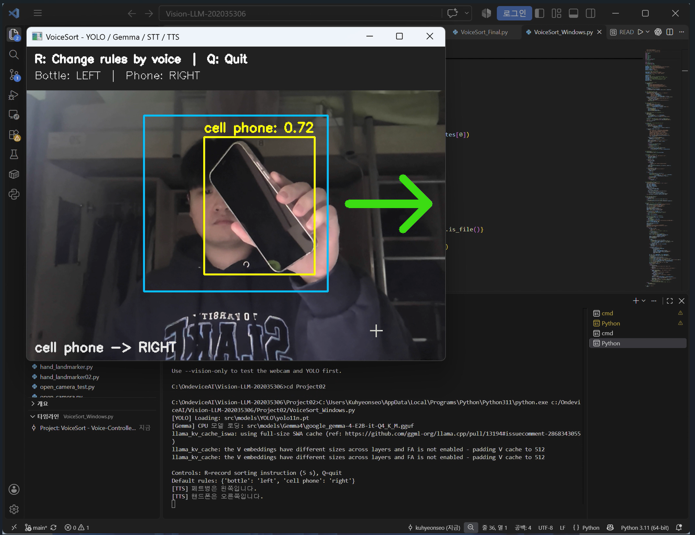
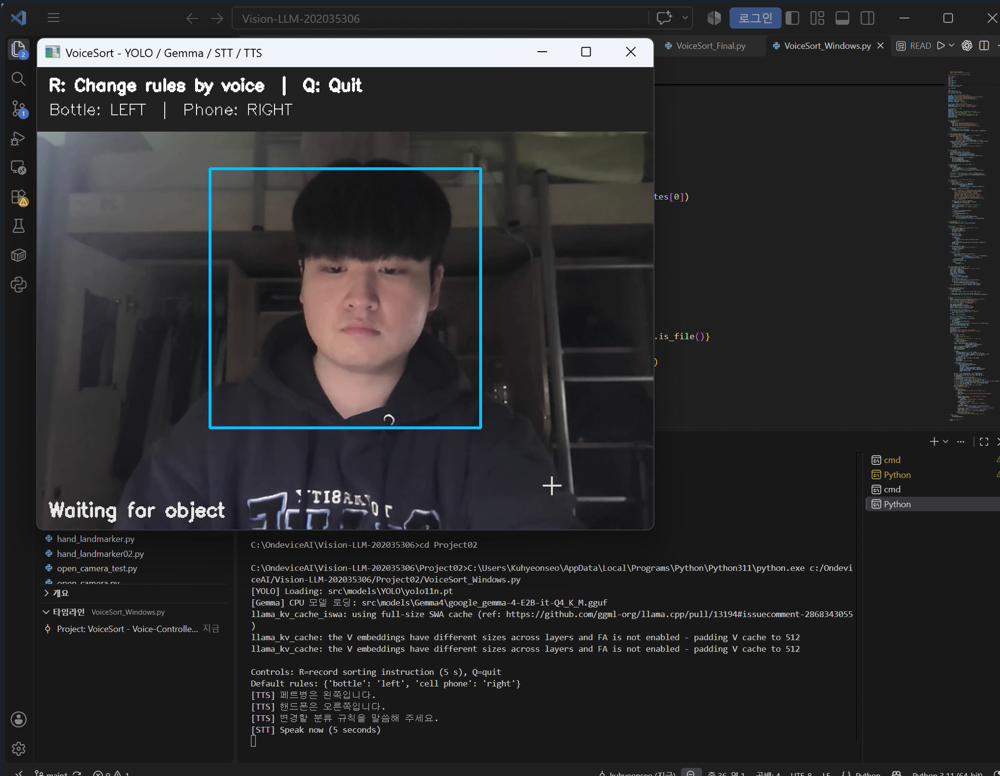
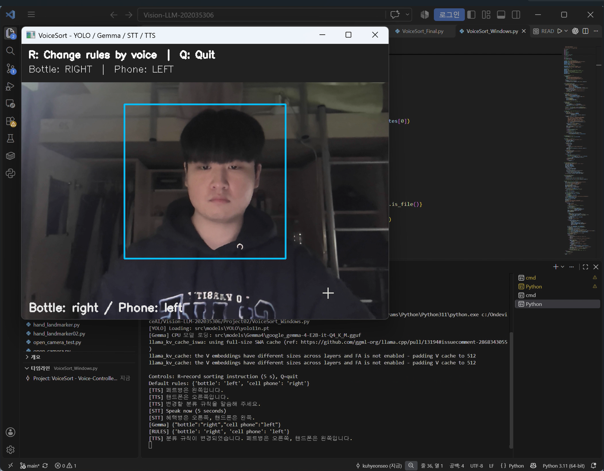
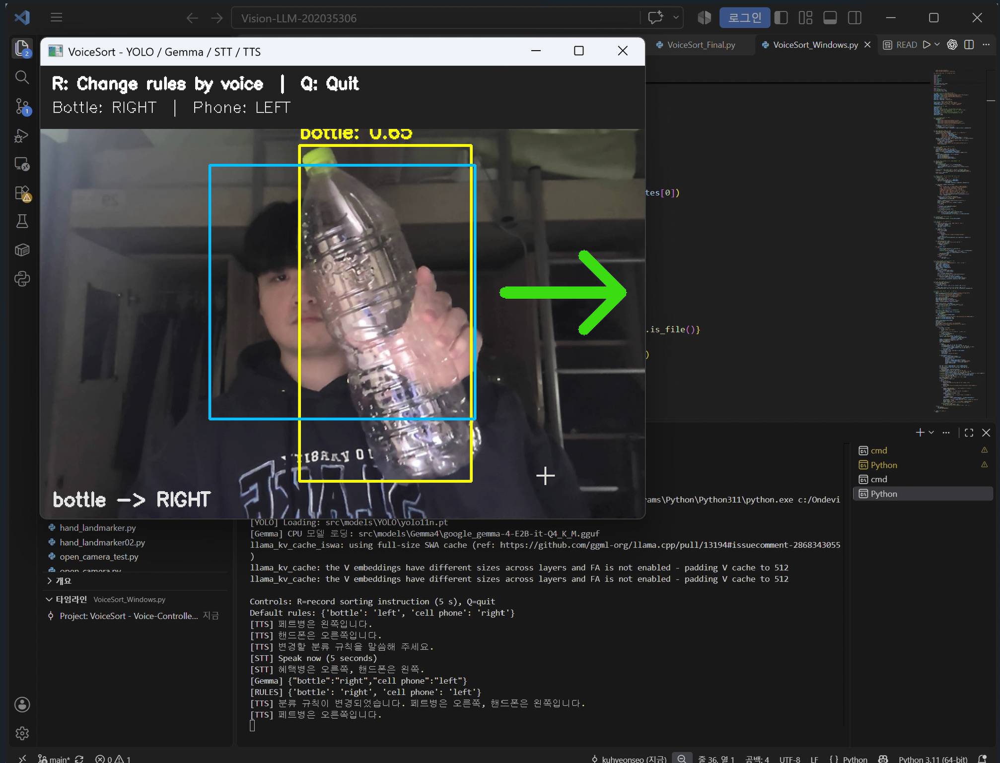
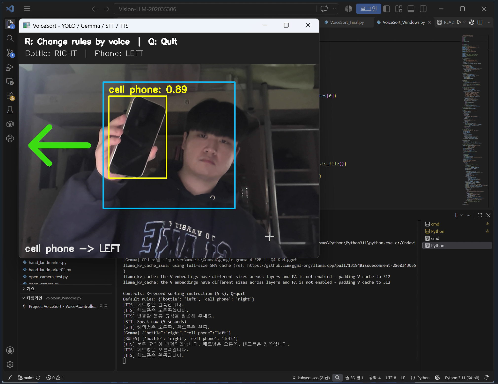

# VoiceSort

**음성 명령으로 분류 규칙을 변경하는 실시간 객체 분류 안내 시스템**

웹캠으로 **페트병과 핸드폰**을 탐지하고, 물체를 이동시킬 방향을 **화살표와 한국어 음성**으로 안내하는 프로젝트입니다.

기본 규칙은 **페트병 → 왼쪽, 핸드폰 → 오른쪽**입니다. `R` 키를 누르고 새로운 규칙을 말하면 Whisper.cpp가 음성을 인식하고, Gemma가 명령을 해석하여 분류 방향을 변경합니다.

실제 물체를 옮기는 장치는 사용하지 않으며, 카메라 앞에서 물체를 손에 들거나 책상 위에 놓고 테스트할 수 있습니다.

---

## 주요 기능

- **객체 탐지:** YOLO11n으로 페트병(`bottle`)과 핸드폰(`cell phone`) 인식
- **방향 안내:** 중앙 영역에서 안정적으로 탐지된 물체에 화살표와 Piper 음성 안내 출력
- **음성 규칙 변경:** `R` 키 → 안내 음성 → 5초 녹음 → Whisper STT → Gemma 명령 해석
- **중복 안내 방지:** 물체가 계속 보이면 음성을 반복하지 않고 화살표만 유지


## 폴더 구조

```text
Project02/
├── VoiceSort_Final.py                 # Jetson 실행용
├── VoiceSort_Windows.py               # Windows 실행용
├── README.md
├── demo/                            # 실행 결과 캡처 이미지
│   ├── 01_bottle_left.png
│   ├── 02_phone_right.png
│   ├── 03_voice_command.png
│   ├── 04_rules_changed.png
│   ├── 05_bottle_right.png
│   └── 06_phone_left.png
├── src/
│   ├── models/
│   │   ├── YOLO/
│   │   │   ├── yolo11n.pt
│   │   │   └── yolo11n_int8.engine
│   │   ├── Gemma4/
│   │   │   └── google_gemma-4-E2B-it-Q4_K_M.gguf
│   │   └── Piper/
│   │       ├── ko_KR-kss-medium.onnx
│   │       └── ko_KR-kss-medium.onnx.json
│   └── audio/                         # 실행 중 음성 파일 생성
├── whisper.cpp/
│   ├── models/ggml-base.bin
│   ├── build-cpu/bin/whisper-cli      # Jetson용
│   └── build/bin/whisper-cli.exe      # Windows용
└── .piper_venv/                       # Jetson의 Piper 가상환경
```

운영체제에 따라 필요한 파일과 실행 환경이 다릅니다. 위 구조는 두 환경을 합쳐 표현했으며, Windows의 Whisper 실행 파일 위치는 빌드 설정에 따라 달라질 수 있습니다.

모델 경로는 **`Project02` 폴더를 기준으로 한 상대경로**입니다.

## 실행 환경

**Jetson Orin Nano**

- Python 3, OpenCV, NumPy, Ultralytics YOLO, `llama-cpp-python`
- YOLO TensorRT INT8 엔진, Gemma GGUF, Whisper.cpp, Piper
- USB 카메라(`/dev/video0`), 마이크(`plughw:2,0`)
- GStreamer 카메라 입력: **YUY2, 640×480, 30fps**

**Windows**

- Python 3, OpenCV, NumPy, Ultralytics YOLO, `llama-cpp-python`
- YOLO `.pt` 모델(CPU), Whisper.cpp, Piper, `sounddevice`
- 기본 웹캠과 마이크 사용

Jetson에서는 기존 **OpenCV·NumPy 버전을 유지**하며, 프로젝트 실행을 위해 임의로 업그레이드하지 않습니다.

### 카메라 입력

Jetson에서는 `261107.py` 실습의 GStreamer 파이프라인을 사용합니다.

```python
pipeline = (
    "v4l2src device=/dev/video0 ! "
    "video/x-raw,format=YUY2,width=640,height=480,framerate=30/1 ! "
    "videoconvert ! video/x-raw,format=BGR ! "
    "queue leaky=downstream max-size-buffers=1 "
    "max-size-bytes=0 max-size-time=0 ! "
    "appsink drop=true max-buffers=1 sync=false"
)

cam = cv2.VideoCapture(pipeline, cv2.CAP_GSTREAMER)
```

Windows에서는 기본 웹캠을 사용합니다. 두 버전 모두 기본적으로 좌우 반전 화면을 표시합니다.

### 실행 방법

**`Project02` 폴더로 이동한 뒤 실행합니다.**

**Jetson**

```bash
cd ~/vision-llm/Project02
python VoiceSort_Final.py
```

**Windows**

```cmd
cd /d C:\OndeviceAI\Vision-LLM-202035306\Project02
python VoiceSort_Windows.py
```

객체 탐지와 화살표만 테스트하려면 `--vision-only`, 카메라 좌우 반전을 끄려면 `--no-mirror` 옵션을 추가합니다.

## 조작 방법

| 조작 / 상황 | 결과 |
|---|---|
| 페트병을 중앙에 보여주기 | 왼쪽 화살표 + “페트병은 왼쪽입니다.” |
| 핸드폰을 중앙에 보여주기 | 오른쪽 화살표 + “핸드폰은 오른쪽입니다.” |
| `R` | 음성 안내 후 5초간 규칙 변경 명령 녹음 |
| “페트병은 오른쪽, 핸드폰은 왼쪽으로 보내 줘” | 분류 규칙 변경 |
| 변경 후 물체 다시 보여주기 | 변경된 방향으로 안내 |
| `Q` 또는 `ESC` | 종료 |

## 실행 결과

### 1. 초기 분류 규칙으로 페트병 인식

페트병을 인식하면 **왼쪽 화살표**를 표시하고 음성으로 안내합니다.



### 2. 초기 분류 규칙으로 핸드폰 인식

핸드폰을 인식하면 **오른쪽 화살표**를 표시하고 음성으로 안내합니다.



### 3. 음성 명령으로 분류 규칙 변경 시작

`R` 키를 누르면 안내 음성 후 **5초간 녹음**하고, Whisper.cpp가 음성을 텍스트로 변환합니다.



### 4. Gemma를 통한 분류 규칙 변경 확인

Whisper.cpp가 '페트병'을 **'혜택병'으로 잘못 인식**했지만, Gemma는 프롬프트에 지정된 객체와 문맥을 참고해 다음 규칙으로 해석했습니다.

```json
{
  "bottle": "right",
  "cell phone": "left"
}
```

일부 STT 오인식을 문맥으로 보완한 사례이며, **항상 올바르게 해석되는 것은 아닙니다.** 변경된 규칙은 화면과 음성 안내에 반영됩니다.



### 5. 변경된 규칙으로 페트병 재인식

페트병을 다시 보여주면 변경된 규칙에 따라 **오른쪽**으로 안내합니다.



### 6. 변경된 규칙으로 핸드폰 재인식

핸드폰을 다시 보여주면 변경된 규칙에 따라 **왼쪽**으로 안내합니다.



## 사용 기술 및 구현 방법

| 기술 | 적용 방법 |
|---|---|
| OpenCV | 웹캠 입력, 중앙 영역 및 화살표 표시, 키 입력 |
| YOLO11n | 페트병·핸드폰 탐지 및 신뢰도 계산 |
| TensorRT | Jetson에서 YOLO INT8 GPU 추론 |
| Whisper.cpp | 사용자 음성을 한국어 텍스트로 변환(STT) |
| Gemma | 자연어 명령에서 객체별 분류 방향 추출 |
| Piper | 안내 문장을 한국어 음성으로 변환(TTS) |
| Python | 규칙 저장, 탐지 안정성 판정 및 상태 관리 |

이 프로젝트는 **영상(YOLO)과 음성(STT)을 함께 활용하는 멀티모달 시스템**입니다. Gemma는 이미지를 직접 입력받지 않고, 음성 명령에서 변환된 텍스트를 해석합니다.

## 핵심 구현 원리

### 1. YOLO를 이용한 객체 탐지

COCO 클래스 `bottle`(39), `cell phone`(67)만 탐지합니다.

```python
results = model.predict(
    source=frame,
    imgsz=640,
    conf=0.60,
    classes=[39, 67],
    verbose=False
)
```

위 코드는 Jetson용 설정 예시입니다. Windows에서는 CPU용 `.pt` 모델과 `imgsz=416`을 사용합니다.

### 2. 중앙 영역과 안정적인 인식

Bounding Box 중심이 화면의 **가로 28~72%, 세로 22~78%** 범위에 들어오면 탐지 후보로 판단합니다.

최근 **10프레임 중 7프레임 이상** 같은 객체가 탐지되면 분류 안내를 시작합니다. 같은 객체가 계속 보이면 음성을 반복하지 않고, **0.9초 이상 보이지 않으면** 탐지 상태를 초기화합니다.

### 3. 음성 명령으로 분류 규칙 변경

초기 분류 규칙은 Python 딕셔너리로 관리합니다.

```python
rules = {
    "bottle": "left",
    "cell phone": "right"
}
```

`R` 키를 누르면 Piper의 안내 후 5초간 음성을 녹음합니다. Whisper.cpp가 음성을 텍스트로 변환하고, Gemma가 명령을 해석하여 JSON 형태의 변경 사항을 생성합니다.

```json
{
  "bottle": "right",
  "cell phone": "left"
}
```

Python에서는 이 결과를 검증한 뒤 `rules`에 반영합니다. Gemma는 **규칙 변경 시에만 실행**하며, 객체를 탐지할 때마다 호출하지 않습니다.

#### Gemma 프롬프트 설계

Whisper.cpp가 인식한 문장을 Gemma가 분류 규칙으로 해석하도록, **실제 `VoiceSort_Final.py`의 `GemmaParser.parse()` 함수**에 다음 프롬프트를 작성했습니다.

```python
prompt = (
    "너는 음성으로 말한 물건 분류 규칙을 JSON으로 변환한다. "
    "물건은 페트병(bottle)과 핸드폰(cell phone)만 가능하다. "
    "방향은 left(왼쪽), right(오른쪽)만 가능하다. "
    "명령에서 명확하게 지정된 물건만 결과에 넣는다. "
    "명령이 불명확하면 {}를 출력한다. 설명 없이 JSON 객체만 출력한다.\n"
    "입력 예시: 페트병은 오른쪽, 핸드폰은 왼쪽으로 보내\n"
    '출력 예시: {"bottle":"right","cell phone":"left"}\n'
    "현재 규칙: {}\n입력: {}\n출력:".format(
        json.dumps(current_rules, ensure_ascii=False), command)
)

response = self.llm.create_chat_completion(
    messages=[{"role": "user", "content": prompt}],
    temperature=0, max_tokens=100
)
```

프롬프트에서는 **분류 대상을 페트병과 핸드폰으로, 방향을 좌우로 제한**하고, 명확하게 언급한 물체만 변경하도록 했습니다. 명령이 불분명하면 빈 JSON `{}`을 반환하도록 요청하며, 입출력 예시와 현재 규칙도 함께 전달합니다.

`temperature=0`은 응답의 무작위성을 낮춰 일관된 규칙 해석을 유도하고, `max_tokens=100`은 짧은 JSON 출력을 고려한 설정입니다.

실제 시연에서는 Whisper.cpp가 **'페트병'을 '혜택병'으로 잘못 인식**했지만, Gemma가 프롬프트의 분류 대상과 문맥을 참고해 의도한 규칙을 생성했습니다. 다만 이런 해석이 항상 성공하는 것은 아니며, 최종적으로 Python에서 **JSON 형식과 허용된 객체·방향**을 검증한 후 규칙을 변경합니다.

### 4. 음성 및 화살표 출력

현재 규칙에 따라 OpenCV로 화살표를 표시하고 Piper로 음성을 생성합니다.

- 페트병 → “페트병은 왼쪽입니다.”
- 핸드폰 → “핸드폰은 오른쪽입니다.”
- 규칙 변경 시 → 변경된 방향 안내

음성 파일은 `src/audio/`에 생성되며, 안내 재생이 끝나기 전에는 새 녹음을 시작하지 않습니다.

## 결과 저장

분류 화면이나 영상은 자동으로 저장하지 않습니다. 실행 중 다음 음성 파일이 생성·갱신됩니다.

```text
src/audio/input.wav       # 사용자 음성
src/audio/response.wav    # Piper 안내 음성
```

분류 규칙은 실행 중에만 유지하며, 프로그램을 다시 시작하면 **페트병 왼쪽 / 핸드폰 오른쪽**으로 초기화됩니다.

## 참고 사항

- 손이 함께 보이거나 물체가 일부 가려지면 탐지 정확도가 달라질 수 있습니다.
- YOLO의 `bottle`은 페트병 전용 클래스가 아니므로 테스트 대상을 페트병으로 제한합니다.
- 소음과 발음에 따라 STT 인식 결과가 달라질 수 있습니다.
- 실제 물체 이동 없이 **좌우 방향만 안내**합니다.


## 한계점 및 향후 개선 방향

이번 프로젝트에서는 **음성으로 분류 규칙을 바꾸고 물체의 이동 방향을 안내하는 기능**까지 구현했습니다. 실제 분류 작업에 활용하기 위해서는 다음과 같은 부분이 아쉬웠습니다.

### 1. 분류할 수 있는 물체가 적음

현재는 **페트병과 핸드폰 두 종류만** 인식할 수 있습니다. 실제 분류 환경에는 다양한 물체가 있으므로, 향후 캔이나 종이 등 탐지 대상을 늘리고 필요하다면 별도의 데이터셋으로 모델을 학습하고 싶습니다.

### 2. 안내 방향이 좌우로 제한됨

현재는 **왼쪽과 오른쪽** 두 방향만 안내합니다. 분류 구역이 많아지면 활용하기 어려우므로, 앞·뒤 방향이나 여러 구역까지 지정할 수 있도록 규칙과 화면을 확장하고 싶습니다.

### 3. 물체가 제대로 이동했는지 확인할 수 없음

현재는 방향만 안내할 뿐 **물체가 올바른 위치에 놓였는지는 확인하지 못합니다.** 향후 분류 구역을 지정하고 이동 후 객체 위치를 다시 확인해, 분류 성공 여부까지 판단하도록 개선하고 싶습니다.

### 4. 로봇팔이 물체를 집을 위치는 제공하지 못함

현재는 YOLO로 객체의 종류와 위치만 표시하며, **로봇팔이 어디를 잡아야 하는지는 알려주지 못합니다.** 앞으로 물체의 Pick 위치를 추정해 제시하고 싶습니다. 실제 로봇팔과 연동하려면 깊이 정보와 로봇 좌표계로의 변환도 필요합니다.

이러한 부분을 개선해 **객체 인식 → Pick 위치 제시 → 물체 이동 → 분류 결과 확인**까지 이어지는 시스템으로 발전시키는 것이 다음 목표입니다.

## 시연 영상

[VoiceSort 전체 시연 영상 보기](Video%20Project%2021.mp4)

## 프로젝트 발표자료

[VoiceSort 프로젝트 발표자료 (PDF)](ai온디바이스.pdf)

